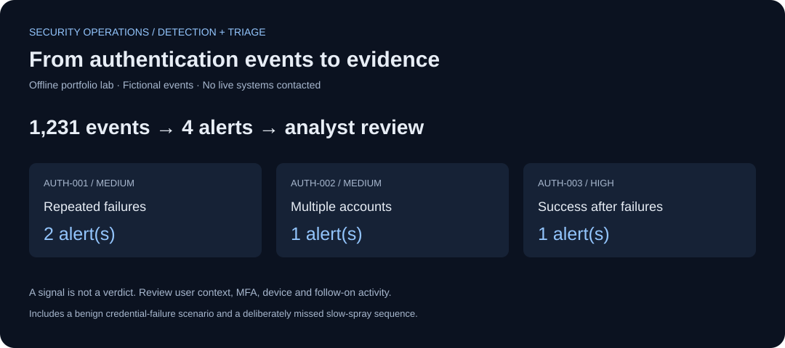
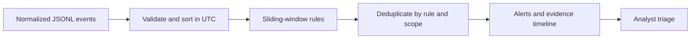

# SOC Alert Triage Lab

**Python · Authentication logs · Detection rules · Evidence timelines · Incident triage**

An offline blue-team portfolio lab that turns normalized authentication events into a reviewable alert queue. Includes testable detection logic, evidence IDs, a triage runbook and an investigation walkthrough.

> All events, identities and incidents are fictional. Public-looking IPs are documentation addresses. This project analyzes local files only.



**[Open the triage report](reports/triage-report.md)** · **[Inspect alerts](reports/alerts.json)** · **[Read the investigation](docs/incident-walkthrough.md)**

## Run locally

Python 3.10+; standard library only. No SIEM account, external service or API key required.

```bash
python3 src/generate_logs.py
python3 src/detect.py
python3 -m unittest discover -s tests -v
```

For a separate file following [the documented schema](docs/event-schema.md):

```bash
python3 src/detect.py --input path/to/events.jsonl --output local-results
```

Keep real logs and personal information out of Git. The committed sample is deterministic and contains no real account data.

## Detection coverage

| Rule | Signal | Scope | Triage priority |
|---|---|---|---|
| AUTH-001 | At least 5 failures within 10 minutes | Same user, source IP and service | Medium |
| AUTH-002 | Failures against at least 6 distinct users within 10 minutes | Same source IP and service | Medium |
| AUTH-003 | A success with at least 5 earlier failures in the preceding 15 minutes | Same user, source IP and service | High |

[Rules and thresholds](rules/auth_rules.json) are configurable. Sliding windows include the lower time boundary; success correlation requires strictly earlier failures. A 30-minute cooldown per rule and scope reduces duplicate alerts. Evidence captures the events visible at the first qualifying trigger, not later events suppressed by cooldown.

The first two patterns are hypotheses aligned with MITRE ATT&CK [Password Guessing](https://attack.mitre.org/techniques/T1110/001/) and [Password Spraying](https://attack.mitre.org/techniques/T1110/003/). Mapping a pattern does not prove the technique or malicious intent.

## What to inspect

- [Detection engine](src/detect.py): UTC ordering, schema validation, distinct-user counts, service boundaries and evidence references.
- [Boundary and negative tests](tests/test_detection.py): threshold edges, out-of-order input, duplicate IDs, benign cases and known misses.
- [Evidence timeline](reports/evidence_timeline.csv): original events supporting the emitted alerts.
- [Triage runbook](docs/triage-runbook.md): what to verify before deciding whether to escalate.
- [Synthetic scenario labels](data/scenario_labels.json): separate evaluation context that the detector never reads.



## Limits that matter

This is a small batch-processing lab, not a production SIEM integration. Slow attempts, distributed sources and success from a different IP can evade these rules. Shared NAT addresses and stale service credentials can cause benign alerts. MFA, device context, asset criticality and follow-on activity are unavailable.

One fixture deliberately produces a benign alert and another deliberately evades the short window. No production precision, recall, incident-response experience or SIEM deployment is claimed. Created with AI assistance; review the code, reproduce the results and explain the tradeoffs.
